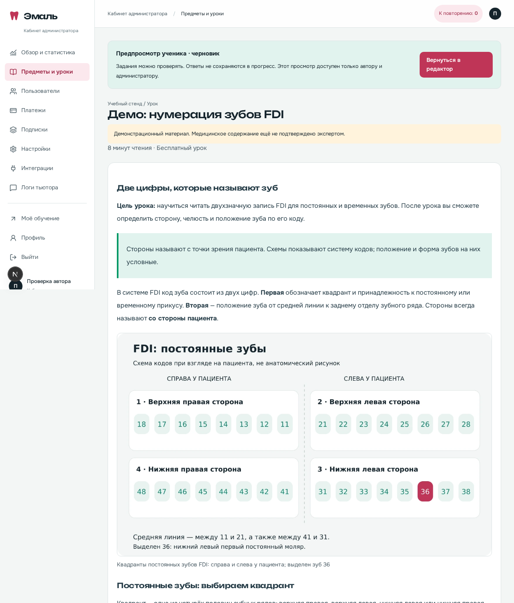

# Демонстрационный урок FDI

Самостоятельно изложенный пример стоматологического учебного материала:
текст, таблица, две авторские схемы, 10 пропусков и 6 вопросов трёх типов.
Источники указаны в уроке: ISO 3950:2016 (страница стандарта) и открытый
обзор FDI notation. Ссылки проверены 11 ноября 2026 года.

Схемы показывают систему кодов и стороны пациента, а не анатомическую форму
зубов. SVG — исходники иллюстраций, WebP — файлы для защищённого хранения.
Внешние иллюстрации, фотографии пациентов и скопированные рисунки не используются.

После обычного обновления и `bash start-mac.command` урок добавится в:

**Предметы и уроки → Пропедевтика стоматологических заболеваний →
Анатомия и нумерация зубов → Демо: нумерация зубов FDI.**

Нажмите **«Открыть как ученик»** в редакторе: в отдельном просмотре можно
проверять пропуски и тест. Ответы там не меняют прогресс. Просмотр закрыт
для обычных учеников и посторонних учителей.

Медицинский урок создаётся черновиком с `needsExpertReview=true` и пометкой
о помощи ИИ. Он не публикуется и не получает фиктивного рецензента. Повторный
запуск не перезаписывает существующий урок и ваши изменения. В рабочем
production-окружении генератор локального демо не запускается.

Пример этого урока в тестовом предмете:



Повторно собрать WebP из исходников можно из корня проекта:

```bash
node --input-type=module - <<'JS'
import sharp from 'sharp';
for (const name of ['quadrants', 'code36']) {
  await sharp(`content-seed/dental-demo/${name}.svg`)
    .webp({quality: 92})
    .toFile(`content-seed/dental-demo/${name}.webp`);
}
JS
```
