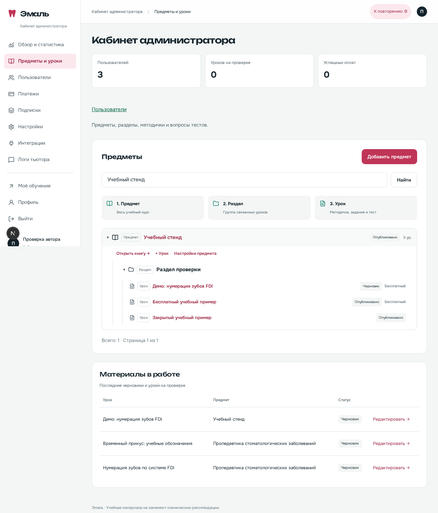

# Создание и проверка урока: инструкция для первого раза

Тема в редакторе — это один урок. Для его создания не нужно подключать ИИ,
Telegram или оплату. Все действия ниже работают в обычном просмотре на Mac.

## Сначала разобраться в названиях

В кабинете администратора и внутри предмета материалы показаны одним
деревом. У каждого узла подписан его уровень: предмет содержит разделы,
а раздел — уроки. Ссылки на урок открывают редактор сразу; настройка названия
и порядка разделов раскрывается отдельно, чтобы не мешать просмотру книги.

| Поле            | Что это значит                            | Пример                             |
| --------------- | ----------------------------------------- | ---------------------------------- |
| Предмет         | Большой учебный курс                      | Предмет, назначенный преподавателю |
| Раздел          | Папка с несколькими уроками               | Введение                           |
| Тема            | Один урок с методичкой и тестом           | Пробный урок                       |
| Название        | Заголовок, который видит ученик           | Как работать с учебным материалом  |
| Slug            | Часть адреса латиницей                    | `probnyi-urok`                     |
| Порядок         | Место в списке; меньшее число идёт раньше | 0, 1, 2                            |
| Бесплатная тема | Урок доступен без покупки                 | Можно включить для знакомства      |
| Время чтения    | Подсказка ученику в минутах               | 5                                  |

Slug автоматически предлагается при создании темы. Обычно его можно оставить.
Изменять адрес уже опубликованного урока без необходимости не стоит:
старые ссылки перестанут подходить.

## 1. Создать черновик

1. Войдите администратором `owner@example.ru` через письмо в Mailpit.
2. В боковом меню откройте «Предметы и уроки», затем нужный предмет. Для первой тренировки можно
   использовать немедицинский предмет «Попробуйте платформу».
3. Нажмите **«Открыть книгу и редактор уроков»**.
4. Слева нажмите **«+ Новый раздел»**, введите название и сохраните.
   Сразу появится форма нового урока в этом разделе: введите название,
   проверьте предложенный адрес и нажмите **«Создать урок»**.
5. Для следующего урока нажмите **«+ Урок в разделе»** либо **«+ Новый урок»**.
   Чтобы открыть другой материал, нажмите его название в дереве. Текст и
   параметры текущего урока сохранятся перед переходом; при ошибке сохранения
   переход не выполняется. Вопрос в несохранённой форме сначала сохраните
   отдельной кнопкой «Сохранить вопрос».

Учитель делает то же в закреплённом предмете через свой кабинет. Создание
предметов и назначения остаются задачей администратора.

Откроется редактор с переходами: **Основное → Методичка → Тест →
Перед публикацией**. Слева — разделы и дерево уроков предмета, рядом — текст
методички и работающий предпросмотр с заданиями. Сверху — параметры урока
и импорт PDF/DOCX для новых черновиков. Внизу рядом находятся компактные
карточки теста и реальный список готовности к публикации. На узком экране колонки располагаются
друг под другом. Черновик ученикам не виден. Он сохраняется автоматически;
кнопка «Сохранить черновик» позволяет сохранить явно. При конфликте двух окон
скопируйте свой текст перед обновлением страницы.

## 2. Написать методичку

Вставьте текст в «Текст методички». Справа — предпросмотр. На узком экране он
расположен ниже текста. Ответы в предпросмотре не попадают в прогресс ученика.

Редактор показывает оформление сразу, как привычный текстовый редактор.
Выделите слово или фразу, затем нажмите **«Жирный»**, **«Курсив»** или
**«Подчёркнутый»**. Для заголовка, цитаты и списка поставьте курсор в абзац
или выделите нужный текст и нажмите соответствующую кнопку. Повторное
нажатие снимает оформление. Есть отмена и повтор действий; на Mac также
работают привычные Cmd+B, Cmd+I и Cmd+U.

Для тренировки вставьте обычный текст: «Сначала прочитайте материал.
Затем выполните задания и пройдите тест». Выделите первую фразу и сделайте
её заголовком, затем попробуйте цитату на другом абзаце.

Исходная разметка скрыта в отдельном раскрывающемся блоке для переноса
старых материалов. При обычном создании урока открывать его не требуется.
Пока он открыт, редактируется исходный текст; для возвращения к визуальному
редактору закройте блок.

Это только учебный пример работы с платформой. Медицинские определения,
числа, классификации и источники заполняет и проверяет специалист.

## 3. Вставить картинку

1. Поставьте курсор в нужном месте текста.
2. Нажмите кнопку с картинкой **«Вставить изображение»** на панели редактора
   либо **«Добавить изображение»** под ним. Откроется окно загрузки.
3. Выберите PNG, JPEG или WebP. По умолчанию допускается файл до 5 МБ.
4. Введите описание: например, «Схема этапов работы с материалом».
   Оно будет подписью под картинкой и описанием для читателя экрана.
5. Нажмите **«Загрузить и вставить»**. Изображение появится в тексте
   и в предпросмотре. Служебную ссылку редактировать не нужно.

Можно чередовать обычный текст и картинки сколько нужно. Нажмите картинку
в редакторе: появятся **«Текст перед изображением»**, **«Текст после
изображения»** и **«Удалить изображение»**. Чтобы изменить порядок, выберите
картинку или поставьте курсор в абзац и нажмите стрелку **«Переместить блок
выше/ниже»**. Стрелки перемещают целый блок. Удаление и перемещение можно
отменить кнопкой «Отменить действие» или Cmd+Z.

Используйте свои или разрешённые для публикации учебные материалы.
Изображение преобразуется в WebP, уменьшается при необходимости, исходные
метаданные файла не сохраняются. Внешние картинки по произвольной ссылке,
SVG и анимация не поддерживаются.

Картинка принадлежит одной теме. Для другой темы загрузите её там заново.
У платного урока она закрыта теми же правами, что методичка; скрытые черновики
доступны только соответствующим сотрудникам. Удаление строки из текста убирает
показ картинки, но не освобождает место среди загрузок темы. По умолчанию
лимит — 30 загрузок; его меняет администратор в «Настройки → Лимиты».

На Mac файлы хранятся в постоянном Docker-томе. Не удаляйте тома при обновлении.
Перед переносом в рабочий интернет-проект изображения нужно перенести
в закрытый S3-бакет проекта; адаптер реализован, ключи задаются в окружении.

### Таблицы

Нажмите **«Вставить таблицу»**. Начальная таблица небольшая, но не имеет
фиксированного размера. Когда курсор стоит в ячейке, над текстом появляется
панель **«Управление таблицей»**:

- «Строка выше/ниже» и «Столбец слева/справа» расширяют таблицу;
- «Удалить строку/столбец» убирают текущую строку или столбец;
- для объединения выделите соседние ячейки мышью или нажмите вторую ячейку
  с зажатым Shift, затем **«Объединить ячейки»**;
- поставьте курсор в объединённую ячейку и нажмите **«Разделить ячейку»**,
  чтобы вернуть отдельные ячейки;
- «Удалить таблицу» удаляет её целиком; отмена действия возвращает таблицу.

В последней ячейке Tab также добавляет строку. Объединения сохраняются после
перезагрузки и в студенческом просмотре; отдельно размечать их не требуется.

## 4. Добавить задания внутри текста

Это короткие упражнения по ходу чтения, отдельно от итогового теста.

1. Выделите в тексте слово или фразу, которая станет ответом.
2. Нажмите **«Пропуск»** на панели редактора.
3. Слово уже подставлено первым вариантом. Добавьте отвлекающие варианты,
   проверьте отметку верного ответа и напишите объяснение.
4. Нажмите **«Сохранить пропуск»**. Он останется на том же месте в предложении.
5. Выберите вариант в предпросмотре и нажмите галочку проверки.

Чтобы изменить пропуск, нажмите на его цветную кнопку прямо в редакторе.
Сразу откроются сохранённые варианты, правильные ответы и объяснение.
С клавиатуры можно перейти к пропуску через Tab и открыть его Enter или
пробелом. Здесь можно изменить тип ответа: один вариант, несколько
вариантов или короткий текст. Один вариант ученик выбирает из списка прямо
в предложении, короткий текст вводит там же. Для нескольких вариантов
показываются чекбоксы после абзаца. В итоговом тесте остаются отдельные
вопросы с видимыми вариантами и чекбоксами.

Все пропуски создаются и редактируются в тексте; отдельного конструктора
ниже методички больше нет. Escape или крестик закрывают окно без сохранения.
Справа остаётся студенческий предпросмотр: в нём выбирают ответ для проверки.
Подробности трёх типов — [exercises.md](exercises.md).

## 5. Составить итоговый тест

В блоке «Тест» заполните форму нового вопроса:

1. Тип ответа и текст вопроса.
2. Варианты и отметки правильных ответов; либо допустимые текстовые ответы.
3. Объяснение: почему ответ правильный и в чём ошибка остальных вариантов.
4. Фрагмент-источник: выберите абзац методички, на который опирается вопрос.
5. При необходимости отметьте вопрос для диагностики.
6. Проверьте ответ в предпросмотре формы и сохраните вопрос.

Повторите для остальных вопросов. По умолчанию нужно 5–15 сохранённых вопросов.
Черновик в несохранённой форме нового вопроса в тест не входит.

Переключатель «Бесплатная тема» находится сверху, рядом с разделом. Он
открывает опубликованный урок без покупки. «Для диагностики» находится у
вопроса: для полного демо предмета нужны минимум три опубликованных и
проверенных урока с такими вопросами, включая хотя бы один бесплатный.
Одна отметка в черновике сама по себе не включает предмет в демо.

**Промпт для проверки ответов ученика не нужен.** Платформа сравнивает ответ
с вашим эталоном. Для нескольких вариантов требуется весь правильный набор
без лишних отметок. Для текста сравнение учитывает допустимые формулировки,
регистр, пробелы и «ё/е»; свободное рассуждение ИИ не оценивает.
Поэтому точность ваших эталонов и объяснений особенно важна.

## 6. Проверить содержание и опубликовать

Есть три разные проверки:

| Проверка                | Кто делает              | Что проверяет                                                                          |
| ----------------------- | ----------------------- | -------------------------------------------------------------------------------------- |
| Техническая             | Платформа               | Разметку, варианты/эталоны, количество вопросов, наличие полей и изображений           |
| Дополнительная рецензия | ИИ по вашему запросу    | Ясность, возможные противоречия и вопросы для сверки                                   |
| Экспертная              | Преподаватель/рецензент | Медицинскую точность, актуальность источников, допустимость формулировок и изображений |

В «Проверка и публикация» заполните автора, рецензента и источники.
Проверьте методичку и каждый вопрос как ученик. После экспертной сверки
поставьте отметку «Проверено экспертом». Список готовности покажет незаполненные
пункты и даст ссылки к нужным блокам. Он не подтверждает медицинскую достоверность.

Затем нажмите **«Отправить на проверку»**, после этого **«Опубликовать»**.
Предмет тоже должен иметь статус публикации — это отдельная настройка на его
странице. Откройте урок учеником или гостем и пройдите задания.

Изменение текста или вопроса снимает экспертную отметку и возвращает урок
в черновик. Старая история ответов сохраняется. После изменений снова проверьте
формулировки и фрагменты-источники, затем повторите публикацию.

## Как пользоваться запросом для ИИ

В конце редактора раскройте «Помощь ИИ при проверке урока» и скопируйте
подготовленный запрос. В него включены текст, сохранённые вопросы, эталоны
и источники. Автор, рецензент и данные аккаунта не добавляются; известные
форматы персональных данных редактируются. Перед передачей всё равно
просмотрите текст сами. Картинки не прикладываются, остаются только подписи.

Можно вставить запрос в выбранный вами ИИ-сервис и получить замечания.
Длинные уроки проверяйте по частям. Это ручной перенос: кнопка не вызывает
внешний ИИ, не ставит экспертную отметку и не публикует урок.
Придумывать такой промпт с нуля вам не требуется.

ИИ-тьютор ученика — другая функция: его базовые инструкции уже заданы
платформой. Он использует опубликованный материал. Загрузка PDF/DOCX
и создание черновиков доступны в [разделе импорта](imports.md).
