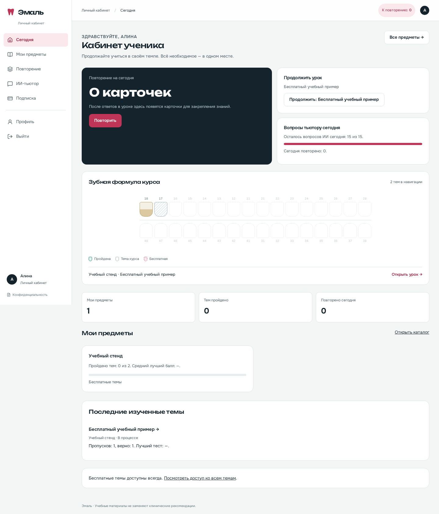
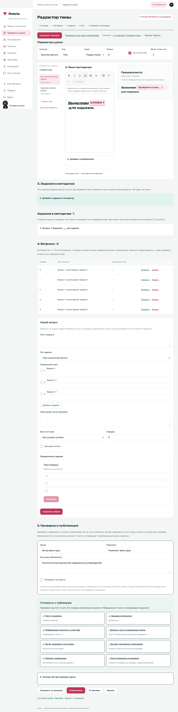
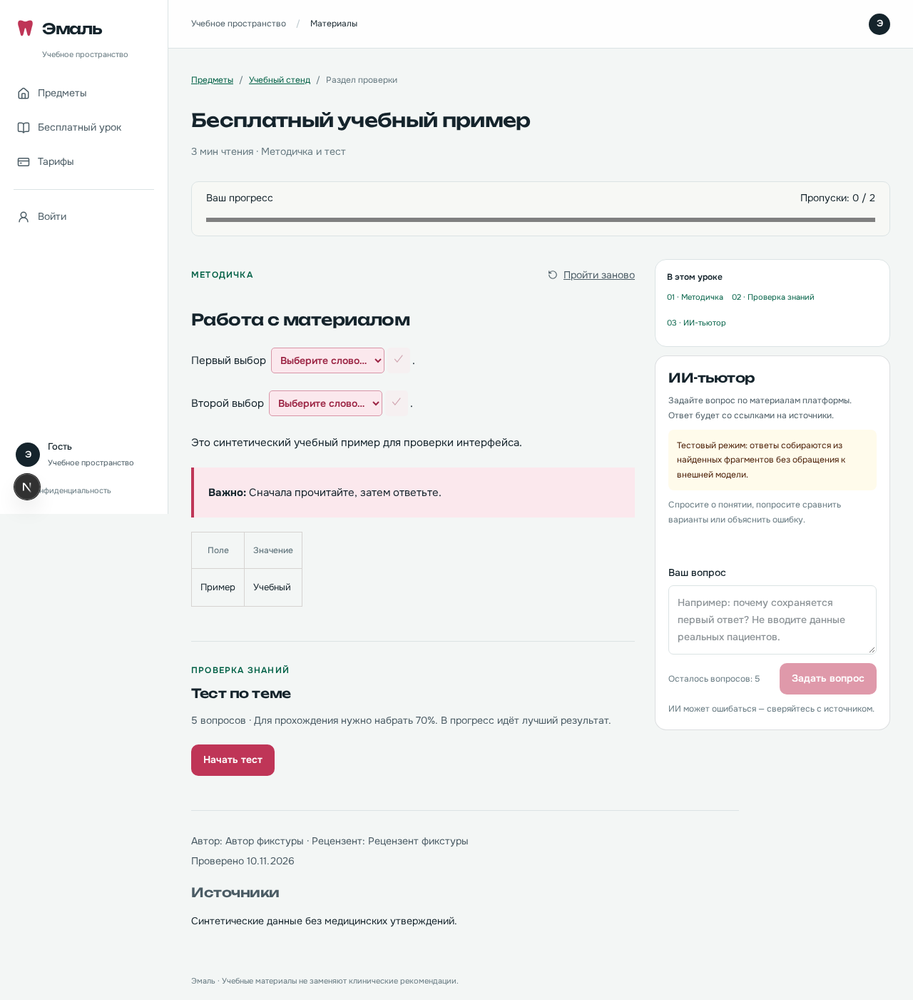

# Интерфейс «Эмаль»

По запросу владельца оформление и структура пересобраны по переданному
`emal-prototype.html`. Изменения затрагивают семь основных экранов и общую
оболочку связанных страниц. База, уроки и прогресс при обновлении сохраняются.

| Экран         | Новое расположение                                                                                           |
| ------------- | ------------------------------------------------------------------------------------------------------------ |
| Лендинг       | Две колонки с работающим примером ответа, карта курса, этапы обучения, предметы, тарифы и FAQ                |
| Ученик        | Боковое меню, повторение на сегодня, продолжение урока, лимит тьютора, карта тем и прогресс                  |
| Учитель       | Закреплённые предметы, показатели и последние материалы в работе                                             |
| Администратор | Предметы, очередь материалов, пользователи; отдельный обзор с показателями и воронкой                        |
| Редактор      | Параметры сверху; дерево уроков, визуальный редактор и предпросмотр в трёх колонках; задания и проверка ниже |
| Интеграции    | Список сервисов слева, фактический режим и инструкция выбранного сервиса справа                              |
| Подписка      | Оплаченный срок, действия с автопродлением и картой, история платежей                                        |

На телефоне боковое меню открывается кнопкой сверху. Закрывается крестиком,
нажатием за пределами меню или Escape. Колонки редактора располагаются одна
под другой. Карту тем можно листать по горизонтали внутри панели.

PDF/DOCX/TXT теперь загружаются при создании урока, во вкладке рядом с ручным
редактором. В существующем уроке импорт открывается сверху. Он создаёт новые
черновики в том же предмете; текущий урок не заменяется. Подробнее:
[создание урока](lesson-authoring.md) и [импорт](imports.md).

В интерфейсе используются данные проекта. Примерные доходы, пользователи,
цены, сроки и медицинские ответы из HTML не переносились. Правильные ответы
по-прежнему выдаются после ответа ученика. Цвет темы на карте не меняет
серверные правила доступа.

Onest и Unbounded загружаются из `public/fonts`, лицензии OFL находятся рядом.
Подключать Google Fonts для просмотра не требуется. Новых npm-зависимостей нет.

Для обновления на Mac скачайте новый архив, откройте Terminal в распакованной
папке и выполните `bash start-mac.command`. Команда использует прежние тома
проекта `emil2-local-preview`. Если копируете файлы поверх прежней папки,
сохраните свой `.env`. Перед обновлением можно выполнить
`bash backup-mac.command` в старой папке.

## Примеры оформления

Снимки сделаны на временных синтетических аккаунтах для проверки интерфейса.
Это не статистика учеников и не окончательное учебное содержание.

## Пропуски и тьютор в уроке

Один ответ выбирается из списка внутри предложения, короткий ответ вводится
там же; несколько ответов показываются чекбоксами. На компьютере тьютор
закреплён справа, на телефоне открывается кнопкой «Спросить тьютора».

